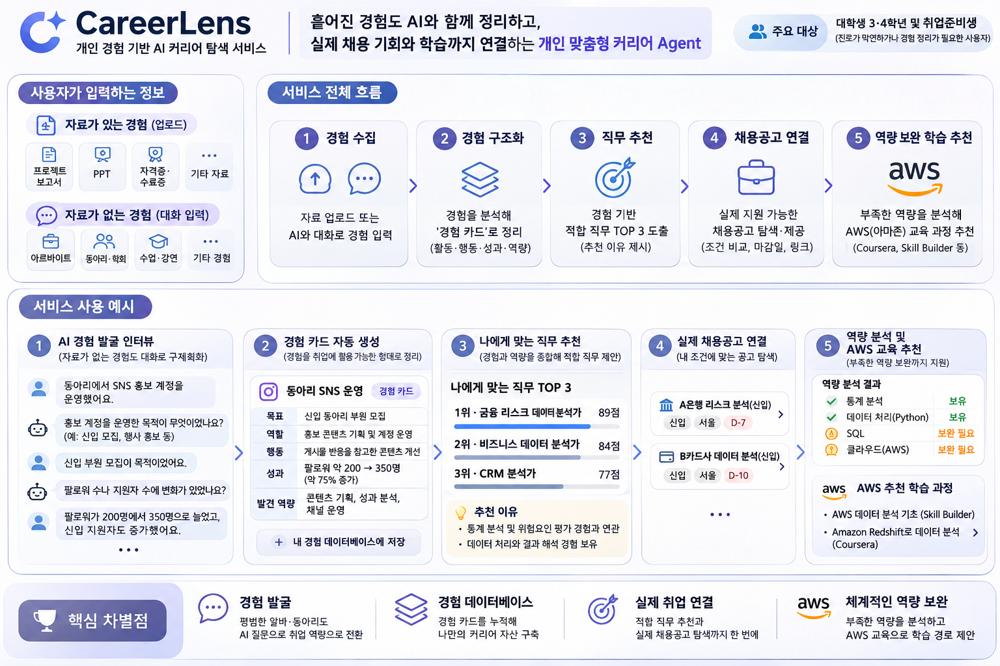

# ♣️ AI Bootcamp Innovation Challenger 2026

- 출처: https://app.notion.com/p/3c7746d99efb80e6ab6bc5fde863b1c2
- Notion 최종 수정: 2026-11-16T18:20:00Z (가져온 날: 2026-11-17)
- 하위 페이지:
  - [세부 로직 및 처리 방법(개발 외)](01-세부-로직-및-처리-방법.md)
  - [aws 계정 제원](02-aws-계정-제원.md)

# 프로젝트 요약

[ai 경진대회 - Google Drive](https://drive.google.com/drive/folders/1dJKhAEPqvy8RqUFi8fkHnaGBJWe5vkkV?usp=drive_link) → 내용 정리: [05-google-drive-ai-경진대회.md](05-google-drive-ai-경진대회.md)

---

## 이미지 전사: `assets/root-project-summary.png`

CareerLens 서비스 한 장 요약 인포그래픽 (1536x1024).

### 헤더

- 서비스명: **CareerLens** — 개인 경험 기반 AI 커리어 탐색 서비스
- 슬로건: 흩어진 경험도 AI와 함께 정리하고, 실제 채용 기회와 학습까지 연결하는 **개인 맞춤형 커리어 Agent**
- 주요 대상: 대학생 3·4학년 및 취업준비생 (진로가 막연하거나 경험 정리가 필요한 사용자)

### 사용자가 입력하는 정보

| 구분 | 입력 방식 | 항목 |
| --- | --- | --- |
| 자료가 있는 경험 | 업로드 | 프로젝트 보고서, PPT, 자격증·수료증, 기타 자료 |
| 자료가 없는 경험 | 대화 입력 | 아르바이트, 동아리·학회, 수업·강연, 기타 경험 |

### 서비스 전체 흐름

| 단계 | 이름 | 설명 |
| --- | --- | --- |
| 1 | 경험 수집 | 자료 업로드 또는 AI와 대화로 경험 입력 |
| 2 | 경험 구조화 | 경험을 분석해 '경험 카드'로 정리 (활동·행동·성과·역량) |
| 3 | 직무 추천 | 경험 기반 적합 직무 TOP 3 도출 (추천 이유 제시) |
| 4 | 채용공고 연결 | 실제 지원 가능한 채용공고 탐색·제공 (조건 비교, 마감일, 링크) |
| 5 | 역량 보완 학습 추천 | 부족한 역량을 분석해 AWS(아마존) 교육 과정 추천 (Coursera, Skill Builder 등) |

흐름: 1 → 2 → 3 → 4 → 5

### 서비스 사용 예시

**① AI 경험 발굴 인터뷰** (자료가 없는 경험도 대화로 구체화)

| 화자 | 발화 |
| --- | --- |
| 사용자 | 동아리에서 SNS 홍보 계정을 운영했어요. |
| AI | 홍보 계정을 운영한 목적이 무엇이었나요? (예: 신입 모집, 행사 홍보 등) |
| 사용자 | 신입 부원 모집이 목적이었어요. |
| AI | 팔로워 수나 지원자 수에 변화가 있었나요? |
| 사용자 | 팔로워가 200명에서 350명으로 늘었고, 신입 지원자도 증가했어요. |
| … | (이어짐) |

**② 경험 카드 자동 생성** (경험을 취업에 활용 가능한 형태로 정리)

카드 제목: **동아리 SNS 운영** `경험 카드`

| 항목 | 내용 |
| --- | --- |
| 목표 | 신입 동아리 부원 모집 |
| 역할 | 홍보 콘텐츠 기획 및 계정 운영 |
| 행동 | 게시물 반응을 참고한 콘텐츠 개선 |
| 성과 | 팔로워 약 200 → 350명 (약 75% 증가) |
| 발견 역량 | 콘텐츠 기획, 성과 분석, 채널 운영 |

버튼: `+ 내 경험 데이터베이스에 저장`

**③ 나에게 맞는 직무 추천** (경험과 역량을 종합해 적합 직무 제안)

나에게 맞는 직무 TOP 3

| 순위 | 직무 | 점수 |
| --- | --- | --- |
| 1위 | 금융 리스크 데이터분석가 | 89점 |
| 2위 | 비즈니스 데이터 분석가 | 84점 |
| 3위 | CRM 분석가 | 77점 |

추천 이유
- 통계 분석 및 위험요인 평가 경험과 연관
- 데이터 처리와 결과 해석 경험 보유

**④ 실제 채용공고 연결** (내 조건에 맞는 공고 탐색)

| 공고 | 태그 |
| --- | --- |
| A은행 리스크 분석(신입) | 신입 / 서울 / D-7 |
| B카드사 데이터 분석(신입) | 신입 / 서울 / D-10 |
| … | |

**⑤ 역량 분석 및 AWS 교육 추천** (부족한 역량 보완까지 지원)

역량 분석 결과

| 역량 | 상태 |
| --- | --- |
| 통계 분석 | 보유 |
| 데이터 처리(Python) | 보유 |
| SQL | 보완 필요 |
| 클라우드(AWS) | 보완 필요 |

AWS 추천 학습 과정
- AWS 데이터 분석 기초 (Skill Builder)
- Amazon Redshift로 데이터 분석 (Coursera)

### 핵심 차별점

| 차별점 | 설명 |
| --- | --- |
| 경험 발굴 | 평범한 알바·동아리도 AI 질문으로 취업 역량으로 전환 |
| 경험 데이터베이스 | 경험 카드를 누적해 나만의 커리어 자산 구축 |
| 실제 취업 연결 | 적합 직무 추천과 실제 채용공고 탐색까지 한 번에 |
| 체계적인 역량 보완 | 부족한 역량을 분석하고 AWS 교육으로 학습 경로 제안 |
