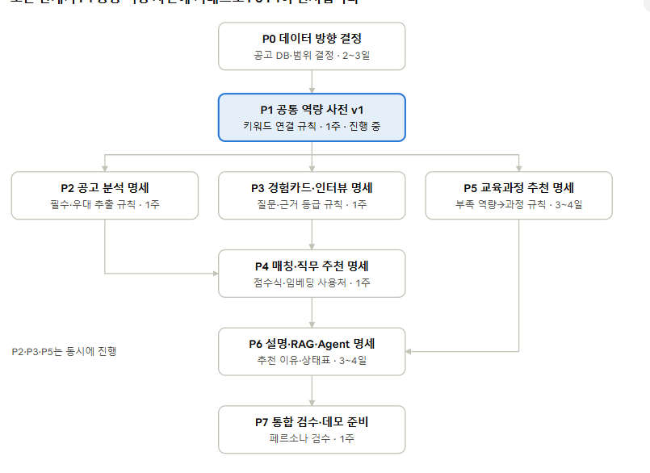

# 세부 로직 및 처리 방법(개발 외)

- 출처: https://app.notion.com/p/415746d99efb80aeabe1f6a692acf7d1
- 경로: AI Bootcamp Innovation Challenger 2026 / 세부 로직 및 처리 방법(개발 외)
- Notion 최종 수정: 2026-11-16T18:19:15Z (가져온 날: 2026-11-17)
- 하위 페이지: [json형식](03-json형식.md) ("과정" 토글 안)
- 첨부: `assets/logic-two-track.png`, `assets/CareerLens_투트랙_구조_비교.csv`

## (토글) 우리가 할거

### 1. 우리가 해야 할 일

| 단계 | 해야 할 일 | 예시 |
| --- | --- | --- |
| ① 기능 정의 | 어떤 기능이 필요한지 결정 | AI 경험 발굴 인터뷰 |
| ② 세부로직 설계 | 어떤 기준으로 작동할지 결정 | 경험의 목적·역할·성과를 질문 |
| ③ 처리방법 설계 | 데이터를 어떤 순서로 처리할지 결정 | 사용자 입력 → LLM 분석 → JSON 변환 |
| ④ 입출력 정의 | 어떤 데이터를 받고 반환할지 결정 | 경험 카드 JSON 구조 |
| ⑤ 예외 처리 | 예상과 다른 상황의 처리 기준 | 성과가 기억나지 않으면 빈값 처리 |
| ⑥ 테스트 기준 | 기능이 정상 작동하는지 판단 | 경험이 누락되지 않고 카드가 생성되는가? |

### 2. 개발팀에 전달하는 결과물

예를 들어 우리가 'AI 경험 발굴 인터뷰' 기능을 설계한다면 다음을 전달해야 해.

- **기능 명세서**: AI 인터뷰가 언제 시작되고, 어떻게 진행되고, 언제 종료되는지
- **처리 흐름도**: 사용자 입력 → 경험 분석 → 추가 질문 → 경험 카드 생성
- **입출력 데이터 형식**: 어떤 JSON을 입력받고 어떤 JSON을 반환할지
- **LLM 프롬프트 및 판단 규칙**: AI에게 어떤 역할을 부여하고, 어떤 기준으로 질문과 결과를 생성하도록 할지
- **테스트 사례**: 실제 입력 예시와 기대되는 출력 결과

### 3. 어디까지가 우리 역할일까?

여기서 팀과 합의할 부분이 하나 있어.

설계만 담당할지, 핵심 분석 로직을 코드로 구현해서 전달할지야.

- 설계 담당: 개발팀이 구현할 수 있을 정도로 세부 명세를 작성
- 로직 개발까지 담당: 프롬프트와 Python 분석 함수를 직접 만들고 테스트한 뒤 개발팀에 전달

둘 다 가능한 역할 분담이지만, 네가 설명한 '세부로직·처리방법' 담당이라면 최소한 설계 명세와 테스트 기준까지는 완성해야 해.

결론적으로 우리 목표는 '이런 기능 만들면 좋겠다'에서 끝나는 게 아니라, 개발팀이 '무슨 데이터를 받아서 어떤 순서로 처리하고, 어떤 결과를 반환해야 하는지' 추가 설명 없이 이해할 수 있는 상태를 만드는 거야.

이제 CareerLens의 다섯 단계 중 첫 번째인 경험 수집 및 AI 인터뷰 기능부터 개발 전달용 명세서를 하나씩 작성하면 돼.

## (토글) 세부 로직과 처리 방법이 뭔가?

### 1. 세부로직과 처리방법이란?

한 줄 요약: AI 서비스가 입력받은 데이터를 어떤 기준으로 판단하고, 어떤 과정을 거쳐 최종 결과를 만들어낼지 설계하는 역할이야.

쉽게 말하면 다음과 같아.

- 세부로직: AI가 무엇을 기준으로 판단하고 어떤 결정을 내려야 하는가?
- 처리방법: 그 판단을 실제로 수행하기 위해 데이터를 어떤 순서와 방법으로 처리해야 하는가?

## (토글) 과정

- 하위 페이지: [json형식](03-json형식.md)

## 첨부 이미지



### 이미지 전사: `assets/logic-two-track.png`

P0~P7 단계별 명세 작성 계획 흐름도 (805x586). 이미지 맨 위에 한 줄 문장이 있으나 위쪽이 잘려 있어 판독 불가.

| 단계 | 이름 | 내용 | 기간 | 상태 |
| --- | --- | --- | --- | --- |
| P0 | 데이터 방향 결정 | 공고 DB·범위 결정 | 2~3일 | |
| P1 | 공통 역량 사전 v1 | 키워드 연결 규칙 | 1주 | **진행 중** (파란색 강조) |
| P2 | 공고 분석 명세 | 필수·우대 추출 규칙 | 1주 | |
| P3 | 경험카드·인터뷰 명세 | 질문·근거 등급 규칙 | 1주 | |
| P4 | 매칭·직무 추천 명세 | 점수식·임베딩 사용처 | 1주 | |
| P5 | 교육과정 추천 명세 | 부족 역량→과정 규칙 | 3~4일 | |
| P6 | 설명·RAG·Agent 명세 | 추천 이유·상태표 | 3~4일 | |
| P7 | 통합 검수·데모 준비 | 페르소나 검수 | 1주 | |

의존 관계(화살표):

```
P0 → P1
P1 → P2, P3, P5      (P2·P3·P5는 동시에 진행)
P2 → P4
P3 → P4
P4 → P6
P5 → P6
P6 → P7
```

주석(이미지 좌측 하단): "P2·P3·P5는 동시에 진행"

## 첨부 파일: `assets/CareerLens_투트랙_구조_비교.csv`

원본 파일명: `CareerLens_투트랙_구조_비교 - 투트랙 비교.csv`

| 구분 | 항목 | 트랙 A · 대학생·취준생 | 트랙 B · 중장년·경력단절 여성 | 비고 |
| --- | --- | --- | --- | --- |
| 공통 | Agent | 하나의 Agent | 하나의 Agent | 사용자가 고른 트랙에 따라 공고 DB와 일부 규칙만 바뀜 |
| 공통 | 역량 사전 | 178개 키워드 | 178개 키워드 | |
| 공통 | 경험카드 · 근거 등급 | 같은 구조, 같은 규칙 | 같은 구조, 같은 규칙 | |
| 공통 | 교육 추천 | 국비 교육과정 | 국비 교육과정 | |
| 트랙별 | 공고 | 미국 Kaggle 6,343건 | 서울시 40,479건 (모집 중, 마감일 있음) | |
| 트랙별 | 주로 다루는 경험 | 프로젝트, 동아리, 인턴 | 이전 직장 경력, 가사·육아·돌봄 경험 → 전이 역량으로 연결 | |
| 트랙별 | 자격증 | 우대 정보로 표시 | 법정 필수 자격이 없으면 "자격 취득 후 지원 가능"으로 안내하고 해당 국비과정 연결 | |
| 트랙별 | 화면 필터 | 경력 3년 이하, 원격 여부 | 지역(구), 근무시간·시간제, 마감일 | |
| 트랙별 | 추천 점수 | 설계서 v0.2 점수식 | 팀원이 만든 추천 엔진 점수식 기준 | |
| 원칙 | 트랙 배정 | 사용자가 첫 화면에서 직접 선택 ("처음 일자리를 찾고 있어요") | 사용자가 첫 화면에서 직접 선택 ("다시 일을 시작하려고 해요") | 나이·성별로 자동 배정하지 않음. 중간에 바꿀 수 있고 경험카드는 유지 |
| 원칙 | 경력 공백 | | 감점하지 않음. 인터뷰에서 Agent가 먼저 묻지 않음 | |
| 계획 영향 | 공고 분석 (P2) | LLM으로 요구역량을 새로 추출 | 팀원이 나눠 둔 업무·필수·우대 문장 재사용, 필수·우대 문장이 없는 약 86%만 보완 | |
| 계획 영향 | 매칭 (P4) | 두 트랙의 점수식을 같은 틀로 맞추는 작업 추가 | 두 트랙의 점수식을 같은 틀로 맞추는 작업 추가 | |
